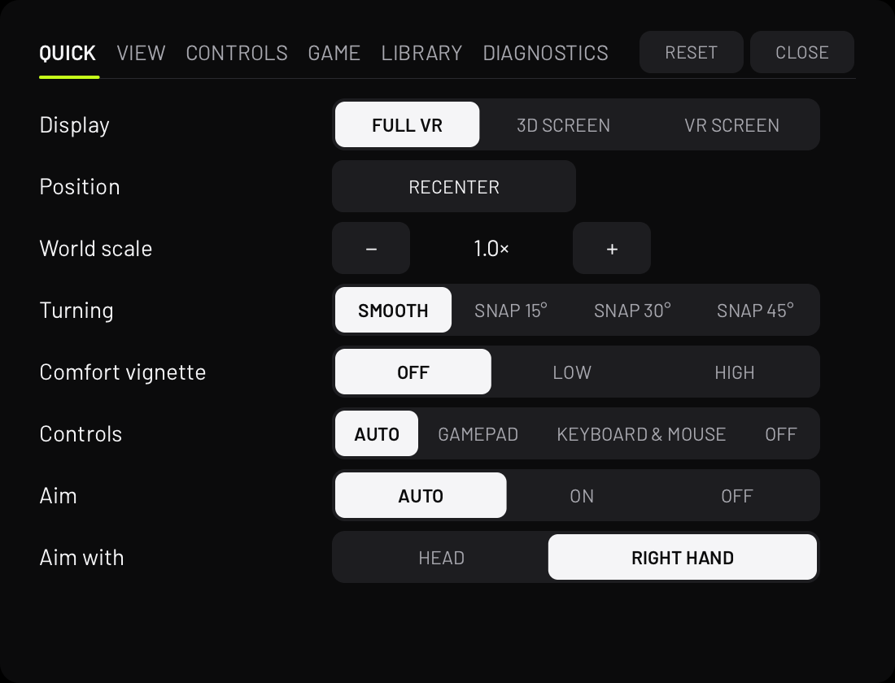

<picture>
  <source media="(prefers-color-scheme: dark)" srcset="app/assets/brand/portxr-mark.svg">
  
</picture>

# PortXR: play flat PC games in VR (Unity, Unreal Engine and Godot)

[](https://github.com/EncidXVII/PortXR/releases/latest)
[](https://github.com/EncidXVII/PortXR/releases)
[](https://github.com/EncidXVII/PortXR/actions/workflows/build.yml)
[](LICENSE)

**PortXR is a free, open-source VR mod for Unity, Unreal Engine and Godot games on PC.** Pick a game you already own, press **Play in VR**,
and play it in full 6DOF stereo with motion controllers: aim with your head or your hand, the gun in your hand, the
game's UI on a panel you can point at. Games that don't suit 3D play on a big screen instead. It works with any
OpenXR headset: Meta Quest 2, 3 and Pro (Link, Air Link, Virtual Desktop), Valve Index, HTC Vive, Pico, Windows Mixed
Reality and others through SteamVR, on Windows and on Linux through Proton.

**[Download the latest release](https://github.com/EncidXVII/PortXR/releases/latest)** · [Guides and help on everyvr.net](https://everyvr.net/portxr) · [Discord](https://discord.gg/WkzGQwu2kz) · [Compatibility](COMPAT.md) · [FAQ](#faq) · [Game scripts](SCRIPTING.md) · [Contributing](CONTRIBUTING.md)

> **Status: early access (0.5).** Unity, Unreal Engine and Godot games are covered. Every game has its own cameras,
> UI and effects, so game reports and per-game scripts are what grow the library. Linux and Unreal Engine support
> are experimental: see [Status and help wanted](#status-and-help-wanted).




## At a glance

| | |
|---|---|
| **What it is** | A VR mod for flat PC games: it goes inside a Unity, Unreal Engine or Godot game and renders it in stereo for your headset, with motion controls |
| **Use it for** | Playing non-VR games you already own in VR: full VR at real scale, the game in 3D on a big screen, or flat on a VR cinema screen |
| **Engines** | Unity (Mono and IL2CPP), Unreal Engine 4.22 and newer, Godot 4; Direct3D 11 and 12 |
| **Platforms** | Windows 10 and 11, 64-bit; Linux through Steam's Proton (experimental) |
| **Headsets** | Any PC VR headset with an OpenXR runtime: Meta Quest 2 / 3 / Pro (Link, Air Link, Virtual Desktop), Valve Index, HTC Vive, Pico, Windows Mixed Reality |
| **Safe to try** | One click to add VR, one click to remove it: the game folder goes back byte for byte. Single-player only; anti-cheat games are refused |
| **Price** | Free. No account, no telemetry |
| **Status** | Early access (0.5): Unity, Unreal Engine and Godot covered; Linux and Unreal Engine are experimental |
| **License** | Open source, `GPL-3.0-only`, © 2026 EncidXVII |

## Highlights

- **One click per game.** A desktop app finds your Unity, Unreal and Godot games on Steam, Epic and GOG, adds VR to
  one and starts it. **Remove VR** puts the game folder back byte for byte.
- **Real VR, not a flat screen.** Stereo 6DOF view at real scale, smooth or snap turning, comfort vignette, recenter.
- **Motion controls without setup.** Controllers act as keyboard & mouse or an Xbox pad; every button can be rebound.
- **Head aim or hand aim.** The game camera follows your head or your right controller; the game's gun moves into
  your hand, and its crosshair sits on what you aim at.
- **Three ways to play.** Full VR (stand in the game), 3D screen (the game in 3D inside a big screen, like a 3D
  monitor) and VR screen (the flat game on a big screen, curved on Virtual Desktop and Meta).
- **Three engines, one VR.** Unity 2018.4 to Unity 6 (Mono and IL2CPP, built-in, URP and HDRP), Unreal Engine 4.22 to
  5.6 and Godot 4, on Direct3D 11 and 12, all with the same controls, menu and settings.
- **Per-game fixes** in small Lua scripts that anyone can share.
- **Safe by design.** Single-player only: anti-cheat games are refused. No account, no telemetry.

## Requirements

- Windows 10 or 11, 64-bit, or Linux with Steam's Proton (see [Linux](#linux)).
- A PC VR headset and an OpenXR runtime: SteamVR, Virtual Desktop, Meta Quest Link, WiVRn or Monado.
- A 64-bit Unity, Unreal Engine (4.22+) or Godot 4 game that renders with Direct3D 11 or 12 (most of them on Windows). See [What works today](#what-works-today).

## Use it in 3 steps

1. Start your headset runtime (SteamVR, Virtual Desktop, Quest Link, anything with OpenXR), then run `PortXR.exe`.
2. Pick a game marked **Installed** and press **Play in VR**. **Settings** (top bar) holds the settings for every game; a game's page can change any of them for that game only, with a link back to the all-games value. After **Play in VR** the page says when the game is in VR (or what to check if it starts flat), and later when you last played it in VR. **Add VR** sets a game up without starting it. PortXR installs itself into the game folder; **Remove VR** puts the folder back byte for byte.
3. In game: **double-tap the left menu button**, look at the back of your left hand, point the right controller at the watch there and pull the trigger, or press F11 for the VR menu: display (Full VR, 3D screen, VR screen), 3D depth, recenter, world scale, comfort (smooth or snap turning by 15/30/45°, a vignette that darkens the edges of your view while you move), height, resolution, button bindings, the game camera to follow, and a frame-time graph. The first time VR starts in a game, a short welcome card walks through recenter, world scale and the controls.

**Uninstall:** close your games, then run `Uninstall PortXR.cmd` in its folder (or `PortXR.exe --uninstall`; on Linux
`./PortXR --uninstall`). It takes VR out of every game it was added to, each folder back byte for byte, and deletes
PortXR's settings. Your game scripts stay. Then delete the folder.

## Linux

PortXR runs Windows Unity, Unreal and Godot 4.3+ games through Proton, Steam's Windows layer: unpack the Linux build
and run `./PortXR`. Older Godot and Unreal games, which play on the VR screen on Windows, aren't listed there.

- **Headset:** WiVRn (standalone headsets) or Monado (wired) work best; SteamVR for Linux works too.
- **Launch options:** Proton only loads PortXR with these in the game's Steam launch options (Properties → General). The game page shows them with a **Copy launch options** button until Steam has saved them:
  `WINEDLLOVERRIDES="winhttp,dwmapi=n,b" PRESSURE_VESSEL_IMPORT_OPENXR_1_RUNTIMES=1 %command%`
- **Linux versions:** where a game has its own Linux build, Steam installs that one, and the library marks it **Linux build**. Force Proton for it (Properties → Compatibility), let Steam download the Windows version, and it is ready.
- **Steam only:** games from other stores run outside Steam's Proton; add their folder and start them from their launcher (Heroic, Lutris) with `WINEDLLOVERRIDES="winhttp,dwmapi=n,b"` set.

## Controls

**Auto** (the default) presents the controllers as an Xbox pad in games that ship a gamepad input library (Unity's Input System, Rewired, InControl, XInput wrappers), and as keyboard & mouse everywhere else. The keyboard & mouse layout:

| Controller | Game sees |
|---|---|
| Left stick | W A S D |
| Right stick | Mouse look |
| Right / left trigger | Left / right mouse button |
| A, B, X, Y | Space, Left Ctrl, E, R |
| Left / right grip | Left Shift, Q |
| Left stick click | C |
| Left menu: tap / hold / double-tap | Esc / Tab / VR menu |
| Point at the UI panel + trigger | Mouse cursor + click (when the game shows a cursor) |

Every button except the sticks can be rebound to a key or mouse button, in the VR menu (Controls tab) or in PortXR.exe (**Button layout** on a game's page, or Settings → Buttons for all games). Each button can also press another key on a double press, when held for half a second, or while the same hand's grip is held (grip + button). The menu warns when two bindings press the same key.

**Off** (Controls, VR menu Quick or the app) leaves the game to your own keyboard, mouse or gamepad: the controllers then only work the VR menu and the laser pointer.

**Gamepad** mode (VR menu, Quick) presents the controllers as an Xbox pad instead. Games on Unity's Input System package and games that read XInput see it. Unity 2021+ games on the old input manager read controllers through Windows.Gaming.Input and do not; keep keyboard & mouse there.

Something wrong? Select the game in PortXR.exe and press **Export logs**. It saves one zip to your desktop to attach to a report.

## What works today

- Direct3D 11 games from Unity 2018.4 to Unity 6: Mono (both .NET 3.5 and 4.x runtimes) and IL2CPP games (BepInEx 6), URP with its post-processing.
- Direct3D 12 games as well, with the same features.
- The game's URP, HDRP or Post Processing v2 camera settings are copied to the eyes, so bloom, tonemapping and the rest show up in VR. Temporal AA is swapped for SMAA (it smears in stereo).
- The game window keeps showing the left eye.
- Head aim: in first-person games the game camera turns to where you look, so you aim with your head; the right stick turns your body. Auto (the default) turns it on while you play (cursor hidden), tries it briefly on each new camera, and keeps it off for third-person cameras that orbit the player, where the right stick turns the game camera as on a flat screen; **Aim** On or Off in the VR menu's Quick tab or the app.
- Hand aim (the default): **Aim with: Right hand** (VR menu Quick, or the app) steers the same way from the right controller instead of your head: the game camera points where the controller points while your view stays on your head. The game still walks where its camera faces, so forward follows your hand. **Weapon in hand** (VR menu Game tab) moves the gun and arms an FPS hangs under its camera into your hand while the view is drawn.
- Crosshair: the game's own crosshair sits in the middle of its UI panel, which stays put while the camera follows your head or hand. While aiming, PortXR moves the middle of the game's UI (the crosshair with its grab and use icons, prompts and hit markers) to what the camera aims at, at its depth. **Crosshair** (VR menu Game tab): Game's, Lime for a plain lime crosshair there instead, or Off.
- The game's UI floats on a see-through panel. When a game paints that panel solid (a full-screen effect on its UI camera), PortXR notices and makes the black see-through, dim tints translucent (View, UI black: Auto, See-through or Keep).
- Intro and cutscene videos that a game draws straight onto its camera play on the theater screen, then the view returns to stereo.
- A round watch face sits on the back of your left wrist; glance at it and the right hand's beam shows; point the beam at the watch (it lights up) and pull the trigger to open the VR menu.
- A laser beam shows where the right controller points while the pointer is on (VR menu, or whenever the game shows its cursor). The pointer clicks the game's menus through the game itself, so it works with the game window minimized or behind other windows; the VR menu always takes the pointer first while it is open.
- Something in the way of your view, like a helmet or the player's own body? VR menu, Game tab, Hide objects: point at it and pull the trigger. PortXR remembers it for that game; Show hidden brings it back.
- 2D games drawn by a perspective camera (Hollow Knight) are scaled so their play plane sits 2.5 m away: the game's own foreground and background layers show their depth. Orthographic 2D games play on the theater screen.
- Per-game Lua scripts fix what one game needs (camera choice, hidden objects, eye offset, game component fields or Godot node properties), in Unity, Godot and Unreal games: see [SCRIPTING.md](SCRIPTING.md).
- 3D screen shows the game in 3D inside the big screen, played as on a 3D monitor: the game's own camera steers the view, your head does not (no head aim or turning). The screen's plane sits at what is in the middle of the view (the character, the wall ahead, a 2D game's play plane), nearer things come out of it and farther ones go behind; **3D depth** sets the strength. Cameras drawn over the game (a weapon, a HUD) and the game's UI stay flat on the screen.
- VR screen shows the flat game on a big screen 3 m away; the laser pointer and the wrist menu work there too. The screen is curved on runtimes with curved layers (Virtual Desktop, Meta), and flat on SteamVR, which has none.
- The screen (3D screen and VR screen) is locked while you play. To move it, open the VR menu and set **Screen** to **Unlocked** in Quick; it locks again when you close the menu. Unlocked, it has handles: faint corner brackets and a bar under the middle, lime under the laser. Drag the bar with the trigger to put the screen anywhere around you (up over a bed, off to one side), drag a corner to resize it; while dragging, the right stick pushes it away or pulls it in (up, down) and sizes it (right, left). **RESET** beside the bar brings back 3 m ahead. Each game keeps its screen. A screen raised or lowered past about 12° shows flat, since the curve wraps around you at eye level.
- If the headset runtime restarts or the session drops, the game continues flat and VR comes back by itself once the runtime is up again.
- IL2CPP games may have stripped engine calls; affected extras switch off with a log line instead of breaking the game.
- The VR menu's Library tab quits the game, or starts another game with VR added without taking the headset off.
- 3D screen and VR screen can show your room around the screen instead of black (**Around the screen: Your room**), on headset software that shares its passthrough with apps; SteamVR does not.
- **Godot 4 games** get full VR. From Godot 4.3, PortXR runs inside the game as it does in Unity games: **Add VR**
  puts a `PortXR` folder and an `override.cfg` beside the game's exe (Remove VR takes them out again), and the game
  gets the same controls, head and hand aim, laser pointer, wrist watch, VR menu, 3D screen and VR screen modes and
  per-game settings. The headset follows the game's camera, also where the game draws its 3D in a SubViewport (a retro
  resolution); the game's 2D UI sits on a panel in front; the controllers act as a gamepad inside the game. It runs the
  game on Direct3D 12, which Godot's official builds include. Godot 4.0 to 4.2 games, and custom builds without
  Direct3D 12, get VR from the engine's own OpenXR instead (an `override.cfg` and one script; no laser pointer or VR menu there).
- **Unreal Engine 4.22 to 5.6 games** get full VR from the same core: **Add VR** puts a `dwmapi.dll` beside the game's
  Shipping exe (`Binaries\Win64`), and the engine then renders both eyes itself. The game's UI sits on a panel in front
  and the controllers act as a gamepad. Full VR, 3D screen or VR screen, with head and hand aim and the crosshair; without a headset
  the game starts as it always did. From UE 4.25 the game's objects are read too: the camera picker, hide objects,
  weapon in hand and scripts that reach actors and components, as in Unity and Godot games.
- **Older Unreal and Godot 3 games** are listed too and play on the VR screen: PortXR
  shows the game's window in VR (Windows' window capture) and turns the controllers into keyboard and mouse, with a
  laser pointer that clicks wherever the game shows its cursor. Nothing is added to the game or its folder; double-tap
  the left menu button to bring the screen in front. Anti-cheat and online-only games are refused here too.
- Not supported: Vulkan and OpenGL games, 32-bit games (no OpenXR runtime supports them). Anti-cheat games (EasyAntiCheat, BattlEye) are refused on purpose. Mono games built with Unity's code trimming (rare; off by default) are marked as not supported: the mod loader cannot start in them. Multiplayer-only games without anti-cheat, games with their own VR mode and trimmed games have **Add VR anyway**, after a caution.
- See [COMPAT.md](COMPAT.md).

## Status and help wanted

PortXR is in early access (0.5). Where each part stands, and what moves it forward:

| Area | Where it stands | What helps |
|---|---|---|
| **Game library** | Engine support is wide (Unity 2018.4 to Unity 6, Unreal Engine 4.22 to 5.6, Godot 4), but each game brings its own cameras, UI and effects. [COMPAT.md](COMPAT.md) lists the checked games | A [game report](https://github.com/EncidXVII/PortXR/issues/new?template=game-report.yml): play a game for 10 to 15 minutes, press **Export logs** and say how it went, also when it just worked. Every report adds a game to the list |
| **Per-game scripts** | A game that needs a fix (the wrong camera, a helmet in the view, an effect that breaks stereo) gets it from a short Lua script | Write one for a game you own and share it: [SCRIPTING.md](SCRIPTING.md) |
| **Unreal Engine games** | Full VR on UE 4.26, 4.27, 5.0, 5.4 and 5.5 games; experimental, requires more testing | Reports from your headset with any UE 4.22 to 5.6 game |
| **Linux (Proton)** | Experimental, requires more testing | Reports with your distro, headset runtime (WiVRn, Monado or SteamVR) and the game |
| **Not built yet** | Vulkan and OpenGL games. 32-bit games cannot work: no OpenXR runtime supports them | A report naming the Vulkan or OpenGL games you miss most |
| **Code signing** | Builds are not signed yet: Windows warns on first run, and some antivirus tools flag the mod loader's `winhttp.dll` in game folders | Nothing: every release has a SHA-256 checksum |

How to send any of these: [CONTRIBUTING.md](CONTRIBUTING.md) and the tester's guide, [TESTING.md](TESTING.md).

## FAQ

**Can I play my game in VR with PortXR?** Most likely, if it is a 64-bit Windows Unity, Unreal or Godot game that
uses Direct3D 11 or 12 and has no anti-cheat. The app tells you per game, before anything is installed. Tested titles and
known issues are in [COMPAT.md](COMPAT.md); report how yours went with a game report.

**Does it work with Meta Quest 3, Quest 2 or Quest Pro?** Yes, through Quest Link, Air Link, Virtual Desktop or
Steam Link, as a PC VR headset. PortXR runs on the PC; the Quest's standalone mode is not supported.

**Which headsets work?** Any headset with an OpenXR runtime on the PC: SteamVR (Index, Vive, Pico, Windows Mixed
Reality, Bigscreen Beyond), Virtual Desktop, Meta Quest Link, WiVRn and Monado on Linux.

**Is it free?** Yes, free and open source under the GPL-3.0.

**Can I get banned?** PortXR refuses games with EasyAntiCheat or BattlEye and flags multiplayer-only games. Use it
for single-player games only.

**Does it change my game files?** It adds its files to the game folder (BepInEx and the plugin in Unity games, a
`PortXR` folder in Godot and Unreal games) and records every file.
**Remove VR** restores the folder exactly; nothing else on your PC changes.

**My game starts flat. What now?** Start your VR runtime first (SteamVR, Virtual Desktop or Quest Link) and put the
headset on. The game page names the runtime PortXR will use and says what to check if VR does not start. Still
flat? **Export logs** and open an issue.

**Does it work with Unreal, Godot or other engines?** Unity, Godot 4 and Unreal 4.22+ games get full VR; older Unreal and
Godot 3 games play flat on the VR screen. Games in other engines aren't listed.

**How is it different from a game's own VR mode?** PortXR adds VR to games that have none. Games with their own VR
mode are marked **Already VR**; start those in VR from Steam.

## Build

Needs Visual Studio 2022 or later Build Tools (C++ and .NET), CMake 3.24+, .NET SDK 8+, Rust (stable, MSVC toolchain). Downloads (BepInEx, the OpenXR loader) are pinned by SHA-256.

```
.\build.ps1
```

`dist\` then holds `PortXR.exe` and the payloads it copies into games (`payload\` for Mono, `payload-il2cpp\` for IL2CPP). The IL2CPP payload needs interop assemblies generated from fixture F3 (see Test); without them the build warns and skips it.

`.\release.ps1` builds and packs `release\PortXR-<version>.zip` with `SHA256SUMS.txt`. CI (`.github/workflows/build.yml`) runs `release.ps1 -MonoOnly` on every push, because the runner has no Unity to generate the interop assemblies.

## Test

The harness runs a fixture game against SteamVR's null driver (no headset needed), drives it through a UDP test channel, and asserts eye order, orientation, scale, tracking, timing, UI, input, theater, Parallax window, menu, stability and a byte-identical uninstall. SteamVR must be closed; its settings are restored afterwards.

```
pip install pillow numpy
python harness\run.py --fixture F1 --soak 600
```

Test windows open on the main screen; `--secondary` moves them to a second monitor. The input gate takes over the real mouse and keyboard for a few seconds, so it only runs with `--input`.

Fixtures are generated from `fixtures/shared` with `fixtures\build.ps1 -Name F1`, then tested with `python harness\run.py --fixture F1`. They need the matching Unity editor, by default under `E:\Unity\Editor\<version>` (`-Editors` to change).

| Fixture | Unity | Backend | Graphics | Pipeline |
|---|---|---|---|---|
| F0 | 2018.4 | Mono, .NET 3.5 | D3D11 | built-in |
| F1 | 2022.3 | Mono | D3D11 | built-in |
| F2 | 2022.3 | Mono | D3D11 | URP + Bloom |
| F3 | 2022.3 | IL2CPP | D3D11 | built-in |
| F4 | 2022.3 | Mono | D3D12 | built-in |
| F5 | 2022.3 | IL2CPP | D3D11 | URP + Bloom |
| F6 | 2022.3 | Mono, Input System package | D3D11 | built-in |
| F7 | 6.3 | IL2CPP | D3D12 | URP + Bloom |
| F8 | 6.3 | Mono | D3D11 | built-in |
| F9 | 2022.3 | Mono, code trimming on | D3D11 | built-in (detection only: the app refuses it) |
| F10 | 2022.3 | Mono | D3D11 | HDRP + Bloom |
| F11 | 2022.3 | Mono | D3D11 | built-in + Post Processing v2 (Bloom) |

Godot VR has its own gates. `python harness\godot_core.py --secondary` runs fixture G1 (`fixtures/G1`, a Godot 4.5
project: a room of coloured boxes, a HUD, a PLAY button, a splash camera before the player's) as an exported game (the
Godot binary beside a `G1.pck`; a pack needs no export templates), adds VR with `dist\PortXR.exe install` as a player
would, checks the shared core through the adapter (laser, gamepad, aim, snap turning, the VR menu, Theater, Parallax,
screen handles) and what SteamVR's compositor shows the test headset, then that Remove VR leaves the folder
byte-identical. `python harness\godot.py --secondary` checks the Godot 4.0 to 4.2 path (the engine's own OpenXR). Both
need the Godot 4.5 editor (`GODOT`, default `E:\Godot\Godot_v4.5-stable_win64_console.exe`).

The IL2CPP plugin compiles against interop assemblies BepInEx 6 generates on a game's first launch. After building F3, `fixtures\interop.ps1` runs a scratch copy once without a window and fills `build\deps\interop-f3`.

## How it works

- `native/` (C++20): the core every engine shares. OpenXR session and frame loop, D3D11 and D3D12 copies into OpenXR swapchains, a Present hook for the desktop mirror (and the D3D12 UI grab), controller actions, haptics, input emulation; and the player's rig (`rig.cpp`: recentring, body turning, head and hand aim, snap turning, comfort vignette, the laser pointer, wrist watch, Theater and Parallax screen with its handles, eye placement), the VR menu (`menu.cpp`, drawn on the CPU and shown as its own layer) and settings. `bridge.cpp` is the one frame every engine adapter calls. Built as `portxr_xr.dll` (Unity), `portxr_godot.dll` (a Godot 4 GDExtension) and `dwmapi.dll` (Unreal, `unreal.cpp`: loaded beside the game's exe, it drives the engine's own stereo renderer; `uobject.cpp` reads the game's objects for the menu's tools and scripts).
- `managed/` (BepInEx 5 plugin for Mono, same sources built for BepInEx 6 / IL2CPP): the Unity adapter. Picks the game camera and reports it with what only Unity knows (its physics rays, a player body's gravity, 2D scenes), renders the two eyes where the core puts them, captures the game's UI from the backbuffer, moves a weapon into the hand, hides objects.
- `godot/core/` (GDScript): the Godot adapter, the same frame from inside a Godot 4 game.
- `app/` (Rust + egui, one `PortXR.exe`): library grid from Steam, Epic, GOG and manual adds (each game marked Full VR, VR screen or why neither; plus a "Not installed" shelf of the Steam library's games that would get Full VR, matched against Wikidata's lists of Unity, Unreal 4/5 and Godot games or, for games Wikidata doesn't know, the engine their Steam Cloud save folders give away, and without anti-cheat, multiplayer-only, own-VR and 32-bit games, that installs through Steam), per-game script import with search, status and store filters and a recently-played order, settings for all games with per-game changes (kept in `%APPDATA%\PortXR` across uninstalls; a game follows a changed all-games value unless it was set differently for that game, in the app or its VR menu), install/uninstall with a receipt (`.vrinstall.json`), launch, export logs, update check against GitHub releases. `PortXR.exe <gameDir>` opens straight to that game's page.

## Safety and privacy

- **Single-player only.** PortXR refuses games with EasyAntiCheat or BattlEye and flags multiplayer-only games. Modding an online game can break its terms of service and get an account banned; do not use PortXR for that.
- **Reversible.** Adding VR copies BepInEx and the plugin into the game folder and records every file in `.vrinstall.json`; **Remove VR** puts the folder back byte for byte. Steam's "Verify integrity of game files" leaves the added files in place; Remove VR is the way out.
- **Network.** The app asks GitHub for the latest release (it shows a link; it never downloads or runs an update by itself) Wikidata for its list of Unity, Unreal and Godot games, and the Are We Anti-Cheat Yet? list on GitHub for games with anti-cheat, to mark Full VR on the Not installed shelf (both lists are downloaded whole, so your library isn't sent anywhere). Nothing else leaves your PC: no account, no telemetry. Logs are only collected when you press **Export logs**, into a zip on your desktop.

PortXR is an independent project, not affiliated with or endorsed by Unity Technologies, Valve, Meta, or any game's developer or publisher. Game names are trademarks of their owners.

## Contributing

Bug reports, game reports and per-game scripts are welcome: see [CONTRIBUTING.md](CONTRIBUTING.md). Security issues: [SECURITY.md](SECURITY.md). Changes per version: [CHANGELOG.md](CHANGELOG.md).

## More PC VR tools from the same author

Four free, open-source tools for PC VR by [EncidXVII](https://github.com/EncidXVII), with one look and one way of working. Guides, downloads and news for all four: [everyvr.net](https://everyvr.net).

| | |
|---|---|
| **[WristXR](https://github.com/EncidXVII/WristXR)** | VR desktop overlay with wrist clock |
| **PortXR (this one)** | Play flat PC games in VR |
| **[FoveaXR](https://github.com/EncidXVII/FoveaXR)** | Foveated rendering for any PC VR game |
| **[SweatXR](https://github.com/EncidXVII/SweatXR)** | VR fitness and calorie tracker |

## License and credit

Copyright © 2026 [EncidXVII](https://github.com/EncidXVII). PortXR is free software under the [GNU General Public License, version 3](LICENSE)
(`GPL-3.0-only`), with the attribution and naming terms in [NOTICE](NOTICE).

- **You may** use it for anything, read the code, change it and share it.
- **If you share it, or anything built from its code,** you must publish your source under the same license, keep
  the copyright lines and the NOTICE file, and say clearly that yours is a changed version.
- **You may not** put its code in a closed-source product, remove the credit, or call a changed version "PortXR" or
  use its logo: see [TRADEMARKS.md](TRADEMARKS.md).

Third-party components and their licenses: [THIRD_PARTY_NOTICES.md](THIRD_PARTY_NOTICES.md). To cite PortXR:
[CITATION.cff](CITATION.cff).
